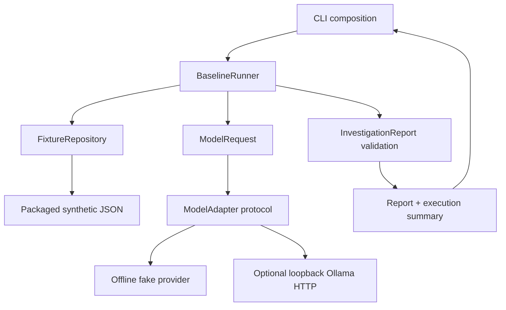

# R00 architecture

R00 is a one-shot assistant baseline. Its only runtime dependency is Python 3.11+. Pytest is a development extra. There is no tool registry, iterative loop, shell/SQL executor, model SDK, server, persistence layer, or action approval system.

## Run sequence

1. CLI parses arguments, chooses a trusted adapter and constructs the runner.
2. Repository validates the incident ID and reads packaged JSON. It validates all incidents, duplicate IDs and evidence references. A failure ends execution before a model call.
3. Runner creates a structured `ModelRequest` with immutable incident data.
4. Runner attempts exactly one `generate` call. Provider exceptions become safe errors; no retries occur.
5. Runner validates the returned object. It requires exact fields, incident identity, fixture observations and references, unconfirmed hypotheses, missing evidence, and recommendation text. The conservative summary and insufficient-evidence status are fixed. Unexpected tool requests or provider-supplied execution fields are rejected.
6. Runner adds its own `ExecutionSummary(1, 0)`. CLI prints text or JSON. Failure output contains a safe error and attempted-call count; successful results contain no hidden mutable state.

## Trust and provenance

Fixture evidence is the source of synthetic observations. Report observations must exactly reproduce every supplied reference/text pair in order. Hypothesis candidates are fixture annotations, never promoted to observations or confirmed root cause. No semantic claim is made that arbitrary fixture text is true: trusted maintainers own fixture quality. Validation checks the provider against those fixtures, not against external reality.

Model output is untrusted data. No model response is executed or dynamically imported. Instruction-like evidence remains text. Trusted in-process adapter implementations can run Python code; the protocol is not a sandbox for third-party plugins. The application does not expose configurable arbitrary adapter imports.

Ollama transport is confined to literal loopback addresses with no redirects or environment proxies. Requests separate system instruction from JSON incident data, omit tools, disable streaming, and use temperature zero. A bounded 64 KiB response read and socket timeout constrain transport. The model is optional and not guaranteed deterministic or available. The strict report validator is shared with the fake provider.

## Scope and limits

The runner records attempted calls, not tokens, latency, recovery state, or full traces. A failed network attempt still counts as one model invocation attempt. Root cause remains unconfirmed and the successful status is `insufficient_evidence`; `failed` is reserved for CLI error envelopes. No root-cause-confirmed report is supported in R00.

There is no global process deadline, operating-system sandbox, schema-generation framework or generalized diagnosis engine. Reads are bounded; trusted local fixture paths are available through the Python API only. R01 loop control and R02 tool governance remain separate future work.
